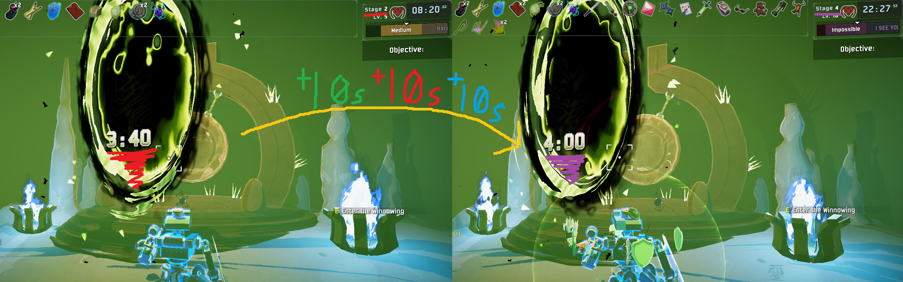
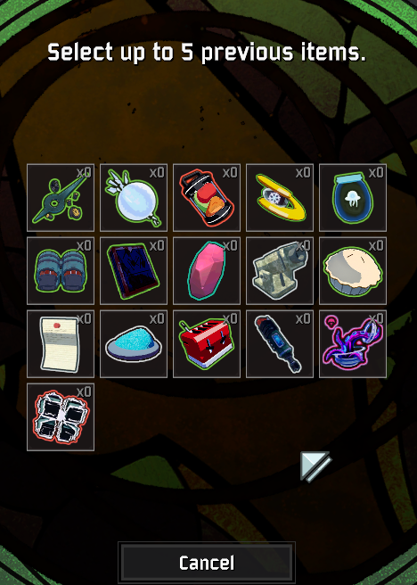

 # Configurable Trials

## Hallowed Concepts is REQUIRED for this mod
Should be pretty obvious since this mod edits one of the core features for that DLC, but figured to get that disclaimer out there just in-case.

## Features
#### Adjustable trial timer
Trials normally have a rigid 3min 30sec timer, now you're free to adjust to your preference both initially and with ways to earn more time.

#### Earnable time
Time can be earned by clearing stages, looping, or finishing Soulbound Threshold. Try [this mod](https://thunderstore.io/c/riskofrain2/p/Slendykray/RenewableTrial/) if you want Karma to increase time too.

#### Custom Starting Items
You can now set items of your choice that you and other players will temporarily have for a trial. This supports many mods that adds items, such as [Sandswept](https://thunderstore.io/c/riskofrain2/p/SandsweptTeam/Sandswept/), [Starstorm 2](https://thunderstore.io/c/riskofrain2/p/TeamMoonstorm/Starstorm2/), [Augmentum](https://thunderstore.io/c/riskofrain2/p/TeamAugmentum/Augmentum/), [Faithful](https://thunderstore.io/c/riskofrain2/p/SpilledSoup_Projects/Faithful/), and many more. (DLC restrictions included) 
 
Hexes can also be added for extra challenge, install [Hexing Chaos](https://thunderstore.io/c/riskofrain2/p/duckduckgreyduck/HexingChaos/) if you want more perplexing problems in your runs as well.

#
The item selector at the start for trials has also been updated to support modded items. 

#### Repeatable Trials
In vanilla, all trials can only be done once in a run (totaling to 9 max trials). This mod allows you to be able to do an infinite number of trials if your heart desires to do so.

#### Trial Filtering
You can now blacklist individual trials, no longer are you potentially forced to yeet enemies off the map or breaking lamps as a melee.

#
All of the features listed above (and more) can be configured to your liking, and supports [Risk of Options](https://thunderstore.io/c/riskofrain2/p/Rune580/Risk_Of_Options/) as well.

## Known Issues
- Item drops in a run (especially white-tier ones) are basically only vanilla. None of my methods item changing methods change items that can be found outside of the trial end hub, and each trial seems to have a specific curtailed set of items to spawn. Might explore an option to change the drops if there's a feasible way to dynamically read in the available item pool but no guarantee on that.

- Some trials (e.g. Abyss) seem to be wonky in multiplayer, I believe this might be on Gearbox's end but do let me know if it's something on my end

- If you encounter any additional problems than the ones I listed above, do send a report on the [github repo](https://github.com/ShandoVK/ConfigurableTrials/issues) or send something in #tech-support on the [Risk of Rain 2 Modding Discord](https://discord.com/invite/5MbXZvd).

## For Developers
My fix just appends CanBeRental to the ItemDef's tags (This is the tag for Ethereal items for DLC4). Applying this tag to the asset's ItemDef should fix the item being missing in the selector.